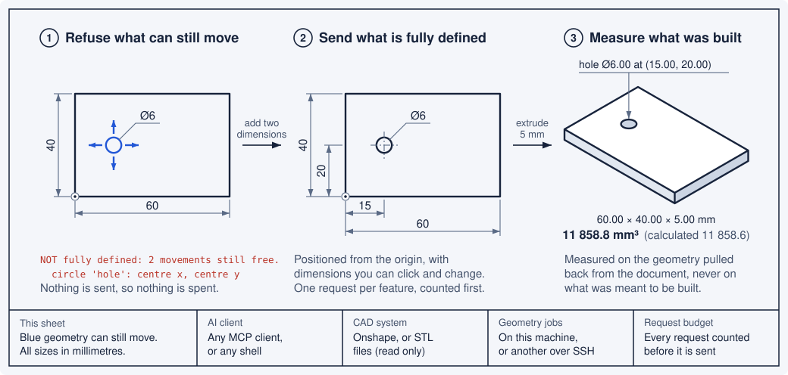
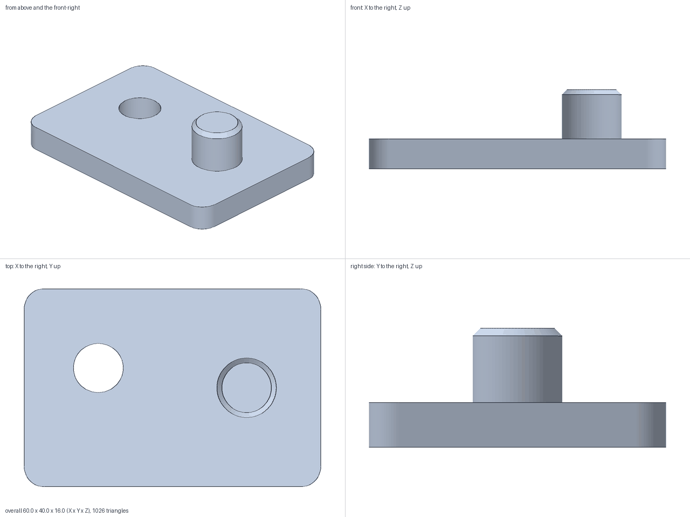

<div align="center">

<picture>
  <source media="(prefers-color-scheme: dark)" srcset="assets/logo-dark.svg">
  
</picture>

### Parametric CAD with an AI, built so you can keep editing the result.

The AI does about 90 % of the job inside your own CAD document:<br>
native features, fully defined sketches, a handful of plainly named variables.<br>
Every result is measured, every request is counted,<br>
and you carry on by hand from where it stopped.

<a href="https://github.com/bogdanr/onshape-mcp/actions/workflows/tests.yml"></a>
<a href="LICENSE"></a>


<a href="GOAL.md">Goal</a> ·
<a href="#try-it">Try it</a> ·
<a href="#the-nine-tools">Tools</a> ·
<a href="#for-ai-agents">For AI agents</a> ·
<a href="src/onshape_mcp/guides/editable-models.md">Modelling rules</a> ·
<a href="docs/ARCHITECTURE.md">Architecture</a>

<br>



<sub>Every number on the sheet was measured by the tool on its live test part.</sub>

</div>

Most CAD made by an AI looks finished and cannot be touched. It arrives as dozens of derived variables,
sketches placed by computed coordinates, and joints set on numbers instead of on geometry. Change one size and
it falls apart, so you build the part again yourself.

Onshape-MCP is a small set of tools that make an AI work the way a careful colleague would. It reads your
document before touching it, draws sketches that are fully defined, proves the result with numbers, and stops
when the request budget you set is used. The one sentence everything is judged against is in
[GOAL.md](GOAL.md).

The name is provisional. Onshape is the first CAD system supported, not the only one intended.

## Try it

Python 3.11 or newer. The core has no dependencies.

```sh
git clone https://github.com/bogdanr/onshape-mcp
pip install ./onshape-mcp
```

Prefer to install nothing? Set `PYTHONPATH=/path/to/onshape-mcp/src` and write `python3 -m onshape_mcp`
wherever this page says `onshape-mcp`.

**Any mesh file, no account, no cost:**

```sh
onshape-mcp check bracket.stl      # volume, size, holes and bosses
onshape-mcp view  bracket.stl      # a picture from four sides (needs Pillow)
```

**Your Onshape document.** Settings live in the folder of the thing you are designing:

```sh
cd ~/my-design
cp /path/to/onshape-mcp/config.example.toml onshape-mcp.toml    # set the budget and where your API keys are
onshape-mcp status
onshape-mcp read "https://cad.onshape.com/documents/<doc>/w/<workspace>/e/<tab>"
```

**Your AI.** In Claude Code, from the same folder:

```sh
claude mcp add onshape-mcp -- onshape-mcp serve
```

Any other MCP client starts the same command, `onshape-mcp serve`, in that folder (or with
`ONSHAPE_MCP_CONFIG` pointing at the settings file). Then say what you want:

> Read this Part Studio and tell me which sketches are not fully defined: *link*

> Make the plate 6 mm thick and move the hole 4 mm up. Show me the dry run first.

> Swing the arm from -30 to 90 degrees on the hinge and tell me the smallest clearance.

## The nine tools

The same nine are offered to an MCP client and as shell commands. Each answer ends with the requests it cost
and the budget left.

| Tool | What it answers or does | Requests |
|---|---|---|
| `cad_status` | The goal, the settings in use, the budget, and whether the keys were found. Can also prove the machine that runs geometry jobs is reachable. | 0 |
| `cad_read` | A Part Studio's whole feature tree as a one-screen outline: each feature, its status, the numbers a person would edit, and for each sketch whether it is fully defined and whether its dimensions carry labels. | 1, or 0 from the saved copy |
| `cad_inspect` | Everything about one feature: a sketch's entities, constraints and what can still move, or a full parameter list. | 0 |
| `cad_check` | Rebuild errors, then each solid body's volume, size and position, whether it is closed, its holes and bosses, and what changed since the last check. | 3 after a change, 1 if unchanged, 0 for a file |
| `cad_view` | A picture from four sides, drawn from the geometry the check saved. | 0 |
| `cad_motion` | An assembly's joints. For one joint: whether its axis sits on real round geometry, and how close every moving part comes to every still one through a range of angles. | 1, plus 3 per Part Studio not yet saved |
| `cad_set` | Changes numbers that exist (dimensions, depths, variables), all in one request. Affected sketches are solved first, so a value a sketch cannot take is refused before anything is sent. | 0 for a dry run, 1 to apply |
| `cad_build` | Adds variables, offset planes, sketches, extrudes, fillets and chamfers, and names parts. Every sketch must pass the gate. | 0 for a dry run, 1 per feature, plus 2 if parts are named |
| `cad_repair` | Adds labels to dimensions that have none, without changing any shape. | 0 for a dry run, 1 per sketch |

Every writing tool does a dry run unless told otherwise. A typical change (read, set, check) costs 5 requests.

## Why the result stays editable

### The sketch gate

Before a sketch is sent, its constraints are solved on your machine and the rank of their Jacobian is
computed, the way a CAD solver does it. A sketch that can still move is refused, with the list of what moves:

```
NOT fully defined: 2 movements still free. These can still move:
  circle 'hole': centre x, centre y
  Add a dimension or constraint for each, from the origin or from another shape.
```

Sketches that pass are written the way a person draws them: true circles with diameters, every constraint with
its symbol, every dimension with a label. The same analysis runs on sketches that already exist, so `cad_read`
tells you which of your own sketches are not fully defined.

### Numbers, not "OK"

`cad_check` pulls the geometry from the document at one exact version and measures it. No tool ever answers a
bare "OK":

```
1 body, 14.96 cm3 in total, overall 60.00 x 40.00 x 16.00 mm
  1      14.96 cm3  60.00 x 40.00 x 16.00 mm  at x 0.00..60.00, y 0.00..40.00, z 0.00..16.00
        1 x boss diameter 12.00 along Z, 9.00 long, centres (x, y): (45.00, 20.00)
        1 x hole diameter 10.00 along Z, 6.00 long, centres (x, y): (15.00, 24.00)
Since version 7c4424ec: bodies 1 -> 1, volume 13.93 -> 14.96 cm3 (+1.03).
```

<p align="center">
  <br>
  <sub>What <code>cad_view</code> returns for that part. A picture is for spotting a wrong shape; measurements come from <code>cad_check</code>.</sub>
</p>

### Motion, checked on the real parts

`cad_motion` turns one joint through a range and measures every moving part against every still one. It also
says whether the joint sits on real geometry, so it follows when you move the hole:

```
1. revolute "Hinge": "Pin <1>" to "Arm <1>", axis through (50.00, 0.00, 25.00) mm along (1.000, 0.000, 0.000)
   the side of "Pin <1>" (3 parts held together): the axis is the centre of round geometry of "Pin <1>" (diameter 8.00, diameter 4.00).
   the side of "Arm <1>": NO round geometry is centred on the axis. ...
Closest approaches, nearest first:
  COLLIDES or touches (closer than 0.6 mm) from -15.00 to -7.00 deg: "Arm <1>" and "Base plate <1>", near (45.00, 71.90, 10.00)
```

### Your edits are never overwritten

Every write is pinned to the version of the document the AI last read. If you changed anything in the
meantime, Onshape refuses the write, and the tool says so and asks for a fresh read.

### The budget is yours

Onshape counts API requests per year, failed ones included. Every request is counted in a ledger file *before*
it is sent, each redirect hop too, and the tool stops when the project's budget is used. The budget is one
number in the settings file. It defaults to 0, and no tool can raise it.

## Three plugs

Each is chosen in the settings file. Changing one does not touch the other two.

| Plug | Today | How it is chosen |
|---|---|---|
| **AI client** | An MCP server on stdio for Claude Code, Claude Desktop or any other MCP client. The same tools as shell commands for any agent, or person, with a terminal. | How you start it: `onshape-mcp serve`, or the commands |
| **CAD system** | Onshape, read and write. STL files, read and measure. | `[backend]` in the settings; a file path in place of a link |
| **Where geometry is computed** | This machine, or another one over SSH. Jobs are plain Python scripts; nothing is installed on the far machine. | `[runner]` in the settings |

Measuring needs only Python. Pictures need Pillow. Motion sweeps need numpy and scipy. A new CAD system
implements one interface, [`backends/base.py`](src/onshape_mcp/backends/base.py); writing and assemblies are
optional parts of it.

## For AI agents

If you are an agent about to use these tools, read the two guides first: the MCP resources
`guide://agent-quickstart` and `guide://editable-models`, or `onshape-mcp guide` in a shell. The server also
sends the short version when you connect:

1. `cad_status`: see the budget. If it will not cover the job, stop and ask the owner for a number.
2. `cad_read` before changing anything. The owner edits the document by hand.
3. Dry-run the change. `cad_set`, `cad_build` and `cad_repair` send nothing unless `dry_run` is false.
4. Show the owner the dry run and its cost, and wait for a yes, for anything larger than a small fix.
5. Apply, then `cad_check`. Report its numbers and the largest thing still unverified.

Never raise the budget or reach the CAD service another way. Never write to a tab the owner did not name.
Never work around the sketch gate, retry a failed write unchanged, measure from a picture, or answer a bare
"done". What every refusal means, and what to do about it, is in the
[quick start](src/onshape_mcp/guides/agent-quickstart.md). Agents changing this code start at
[AGENTS.md](AGENTS.md).

**Owners:** to hold an agent to this in your design project, paste these lines into its `CLAUDE.md` or
`AGENTS.md`:

```markdown
## CAD work
- All CAD work here goes through the onshape-mcp tools (`cad_*`, or the `onshape-mcp` command).
- Before the first tool call, read `guide://agent-quickstart` and `guide://editable-models`
  (in a shell: `onshape-mcp guide`).
- The request budget is in `onshape-mcp.toml`. Do not edit that file. Ask me for a number before a job
  that needs more.
- Show me the dry run of anything that adds or changes more than one feature, and wait for my yes.
```

## Tests

```sh
PYTHONPATH=src python3 -m unittest discover -s tests
```

The tests need no network and no keys. They run against a stand-in for Onshape's servers and a fixture cut from
real Onshape responses with the identifiers replaced. Set `ONSHAPE_MCP_TEST_SSH_HOST=user@machine` (and
`ONSHAPE_MCP_TEST_SSH_PYTHON`) to also test the SSH runner on a real machine.

Simulated answers cannot tell when Onshape changes what it accepts, so there is also a live test. It builds,
measures, changes, repairs and names a small part in an empty Part Studio, in 27 counted requests of your own
budget:

```sh
PYTHONPATH=src python3 tests/live_smoke.py "https://cad.onshape.com/documents/<doc>/w/<workspace>/e/<empty tab>"
```

## What it does not do yet

- **Sketches:** no tangent or angle constraints, no mirror or pattern, and only on Top, Front, Right or a plane
  offset from them. Corners are rounded with a fillet step.
- **Features:** extrude, fillet, chamfer. No revolve, sweep, loft, shell or pattern.
- **Assemblies:** read and checked, not built. Flat assemblies only (no sub-assemblies), revolute joints only.
- **Files:** STL only, read only.
- A sketch that uses tangent, offset or another part's geometry is reported as "not assessed", not judged.

## Documentation

- [GOAL.md](GOAL.md): the one sentence, the five tests, and what this is not
- [Agent quick start](src/onshape_mcp/guides/agent-quickstart.md): the loop, the costs, every refusal and what to do
- [Modelling rules](src/onshape_mcp/guides/editable-models.md): how to build a model a person can keep editing
- [Architecture](docs/ARCHITECTURE.md): the modules, how to add a plug, what live testing taught us about Onshape
- [config.example.toml](config.example.toml): every setting, with comments
- [AGENTS.md](AGENTS.md): for agents using the tools or changing the code

## Status

Version 0.9: early, and used on one person's real projects. Every tool has passed a live test on Onshape.
One check is left before 1.0, and it needs a person's eyes: that every dimension the tool writes shows its
number in the sketch editor, and that the model rebuilds when the number is changed there.

Not affiliated with or endorsed by Onshape or PTC. Onshape is a trademark of PTC Inc.

## License

GPL-3.0-only. See [LICENSE](LICENSE).
